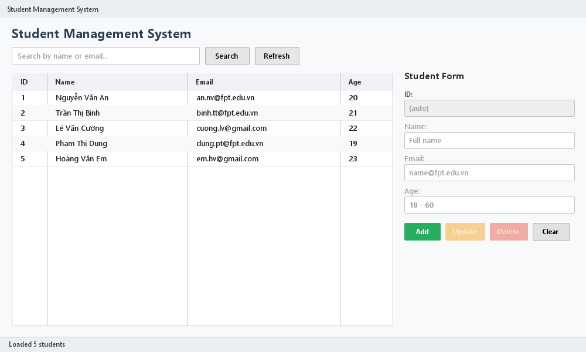
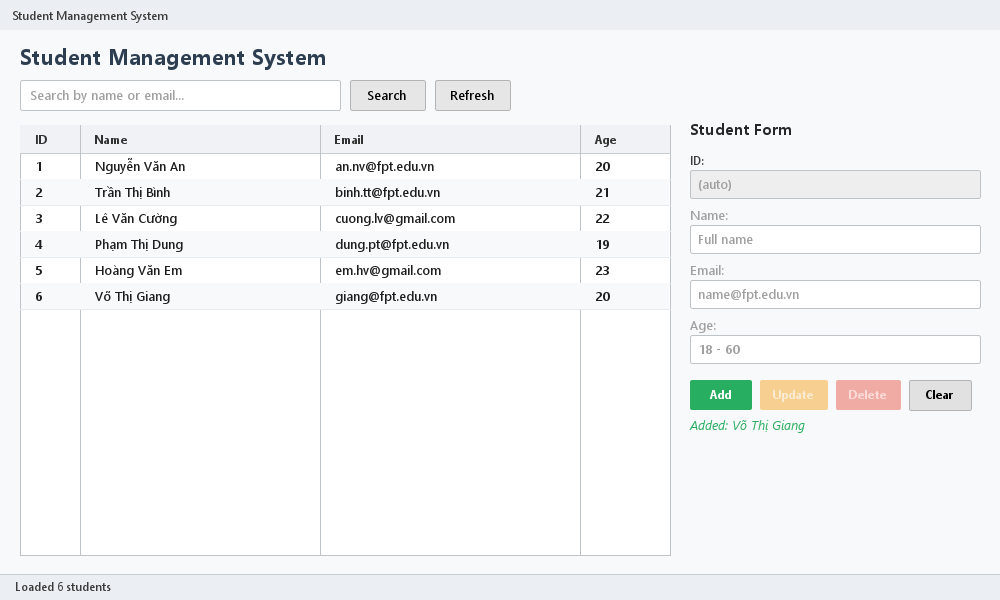
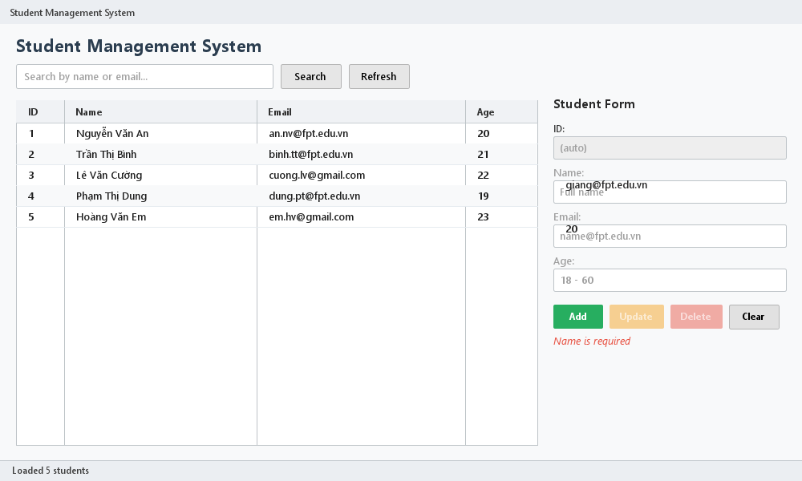
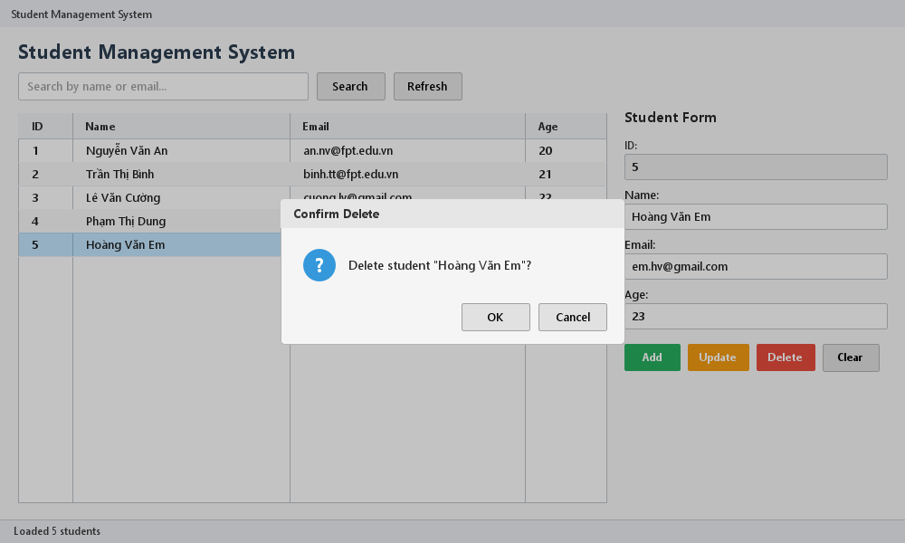

# Student Management System

Hệ thống Quản lý Sinh viên xây dựng bằng **JavaFX** kết hợp **Spring Boot & Spring Data JPA** theo kiến trúc Multi-module Maven N-Layer (`ui-module` và `data-module`).

---

## 1. Yêu cầu môi trường

- **Java Development Kit (JDK):** JDK 21
- **Apache Maven:** 3.9+
- **Spring Boot:** 4.1.x
- **JavaFX:** 21.0.5
- **Database:** Microsoft SQL Server (chạy ứng dụng), H2 in-memory (chạy automated tests)

---

## 2. Kiến trúc dự án (N-Layer Architecture)

```
┌────────────────────────── ui-module ──────────────────────────┐
│  student-view.fxml + style.css            (View)              │
│  StudentController  @Component            (Controller)        │
│  JavaFxApplication / Launcher / StudentManagementApplication  │
│  application.properties                   (cấu hình DB)       │
└───────────────┬───────────────────────────────────────────────┘
                │ chỉ phụ thuộc INTERFACE StudentService
┌───────────────▼─────────── data-module ───────────────────────┐
│  StudentService            (interface)                        │
│  StudentServiceImpl        @Service @Transactional            │
│        │ constructor injection                                │
│  StudentRepository extends JpaRepository<Student, Long>       │
│        │ Spring Data JPA tự sinh implementation               │
│  Student  @Entity                                             │
└───────────────┬───────────────────────────────────────────────┘
                ▼
        SQL Server (StudentDB)   |   H2 in-memory (test)
```

```
student-management/
├── pom.xml                                   (parent = spring-boot-starter-parent)
├── data-module/
│   ├── pom.xml
│   └── src/
│       ├── main/java/vonguyenkhanh/example/datamodule/
│       │   ├── pojo/Student.java                         (Entity)
│       │   ├── repository/StudentRepository.java         (Repository)
│       │   ├── exception/ValidationException.java        (Exception)
│       │   ├── exception/StudentNotFoundException.java   (Exception)
│       │   ├── service/StudentService.java               (Service Interface)
│       │   └── service/StudentServiceImpl.java           (Service Implementation)
│       └── test/java/vonguyenkhanh/example/datamodule/
│           ├── DataTestApplication.java
│           ├── repository/StudentRepositoryTest.java
│           └── service/StudentServiceImplTest.java
└── ui-module/
    ├── pom.xml
    └── src/main/
        ├── java/vonguyenkhanh/example/
        │   ├── StudentManagementApplication.java         (@SpringBootApplication)
        │   └── uimodule/
        │       ├── JavaFxApplication.java                (JavaFX Application Lifecycle)
        │       ├── Launcher.java                         (Main Entrypoint)
        │       └── controller/StudentController.java     (UI Controller)
        └── resources/
            ├── application.properties                    (DB configuration)
            ├── student-view.fxml                         (UI FXML layout)
            └── style.css                                 (UI Styling)
```

---

## 3. Cài đặt và cấu hình cơ sở dữ liệu

### 3.1 Tạo Database trong SQL Server
Mở SQL Server Management Studio (SSMS) và thực thi script sau:
```sql
IF DB_ID('StudentDB') IS NULL CREATE DATABASE StudentDB;
```

### 3.2 Cấu hình `application.properties`
Chỉnh sửa file `ui-module/src/main/resources/application.properties` để phù hợp với tài khoản SQL Server của máy:
```properties
spring.application.name=student-management
spring.main.web-application-type=none

spring.datasource.url=jdbc:sqlserver://localhost:1433;databaseName=StudentDB;encrypt=false;trustServerCertificate=true
spring.datasource.username=sa
spring.datasource.password=sa
spring.datasource.driver-class-name=com.microsoft.sqlserver.jdbc.SQLServerDriver

spring.jpa.hibernate.ddl-auto=update
spring.jpa.show-sql=true
spring.jpa.properties.hibernate.format_sql=true
```

### 3.3 Dữ liệu mẫu (Tùy chọn)
```sql
USE StudentDB;
INSERT INTO students(name, email, age) VALUES
(N'Nguyễn Văn An', 'an.nv@fpt.edu.vn',   20),
(N'Trần Thị Bình', 'binh.tt@fpt.edu.vn', 21),
(N'Lê Văn Cường',  'cuong.lv@gmail.com', 22),
(N'Phạm Thị Dung', 'dung.pt@fpt.edu.vn', 19),
(N'Hoàng Văn Em',  'em.hv@gmail.com',    23);
```

---

## 4. Hướng dẫn Build, Test và Chạy ứng dụng

### 4.1 Build toàn bộ dự án
Tại thư mục gốc `student-management`:
```bash
mvn clean install
```

### 4.2 Chạy toàn bộ Automated Tests
```bash
mvn test
```
- `StudentRepositoryTest`: 10/10 test methods pass.
- `StudentServiceImplTest`: 16/16 test runs pass.

### 4.3 Khởi chạy ứng dụng JavaFX
Cách 1: Sử dụng Maven
```bash
mvn -f ui-module/pom.xml spring-boot:run
```
Cách 2: Trong IntelliJ IDEA / Eclipse
- Chạy class `vonguyenkhanh.example.uimodule.Launcher`.

---

## 5. Ảnh chụp màn hình ứng dụng (Screenshots)

### 5.1 Danh sách sinh viên (TC01)
Hiển thị danh sách sinh viên ban đầu, trạng thái `Loaded 5 students`, các nút Update và Delete ở trạng thái vô hiệu hoá khi chưa chọn dòng.


### 5.2 Thêm sinh viên thành công (TC05)
Thêm sinh viên mới thành công, thông báo màu xanh `Added: Võ Thị Giang`, danh sách tự động cập nhật lên 6 sinh viên.


### 5.3 Xác thực dữ liệu đầu vào (TC06)
Kiểm tra tính hợp lệ khi thêm với tên bị bỏ trống, thông báo lỗi màu đỏ `Name is required`, dữ liệu đang nhập được giữ nguyên.


### 5.4 Hộp thoại xác nhận xoá (TC11)
Khi nhấn nút Delete, ứng dụng hiển thị hộp thoại xác nhận `Delete student "Hoàng Văn Em"?`.

